# HuiwenMincho-AI v2.1 — a supplement for vertical reading

English | [正體中文](README.zh-Hant.md)

HuiwenMincho-AI v2.1 is an extended build of the 汇文明朝体 (Huiwen Mincho) letterpress-style typeface. It adds about 2,400 code points that were missing (punctuation and symbols for vertical text, Latin and Vietnamese letters, IPA, Greek incl. polytonic, Cyrillic, enclosed and CJK symbols, radicals, bopomofo extensions, box drawing, ...) and ships with two reading-oriented variants, **S2T** (simplified → traditional) and **T2S** (traditional → simplified).

## Files

The font files are attached to the [latest GitHub Release](https://github.com/SEKY443/HuiwenMincho-AI/releases/latest); they are not stored in the git history.

| File | What it is |
|---|---|
| `HuiwenMincho-AI-v2.1.ttf` | The main font. |
| `HuiwenMincho-AI-v2.1-S2T.ttf` | Same glyphs; typing simplified characters displays traditional forms (with context-aware handling of one-to-many characters, e.g. 后/後/皇后, 发/發/髮, 干/乾/幹/榦, 里/裡/裏). |
| `HuiwenMincho-AI-v2.1-T2S.ttf` | The reverse: typing traditional characters displays simplified forms. |
| `HuiwenMincho-AI-v2.1-CP.ttf` | Same glyphs as the main font, but full-width punctuation and symbols (、。，：；！？ brackets, quotation marks, ～ ★ ○ ...) are **centred** in their em box, in horizontal and vertical forms (like I.Ming's "CP" build). Cell-filling shapes and box drawing are left untouched so that they still join. |
| `example/` | Specimen images (per language, per version, horizontal and vertical) rendered with these fonts. |

All four carry the same name/licence metadata as the original font (Public Domain; credits to the original authors are kept in the name table).

## Intended use

This font is made **for reading** (books, long-form text, vertical or horizontal). It is **not well suited to UI design**: the letterpress roughness, the narrow spacing marks and the tall vertical metrics were tuned for running text, not for buttons, menus or small interface labels.

Pick the version that matches how you read: the main font for mixed text, **S2T** if you prefer to read traditional characters (and type or receive simplified text), **T2S** if you prefer simplified, and **CP** if you want centred punctuation and symbols.

Repository: <https://github.com/SEKY443/HuiwenMincho-AI>

## Specimen

Box drawing and a wide mix of scripts and symbols, set with the main font. Horizontal:

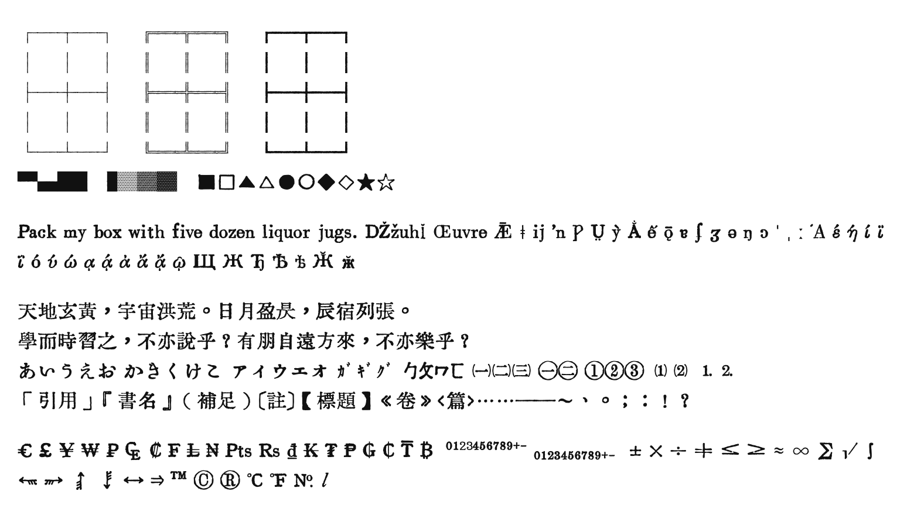

Vertical (right to left, `writing-mode: vertical-rl`):

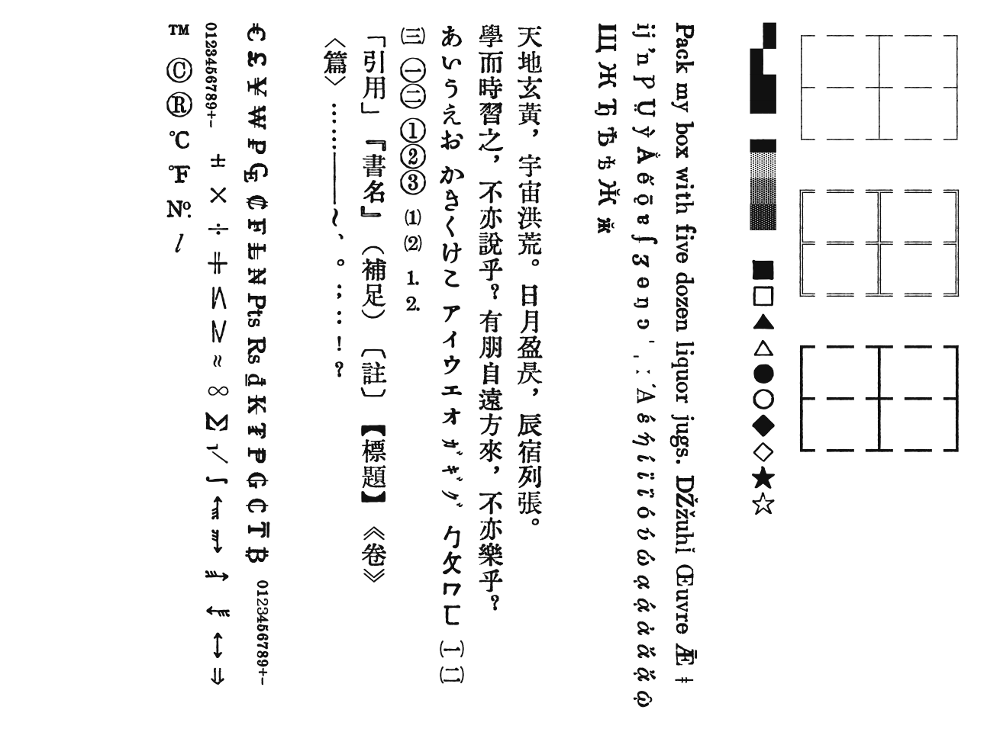

## Version comparison

The same text in each version. In S2T the simplified text displays as traditional forms, in T2S the traditional text displays as simplified ones (the converter also swaps 「」 for “”), and CP centres punctuation and symbols.

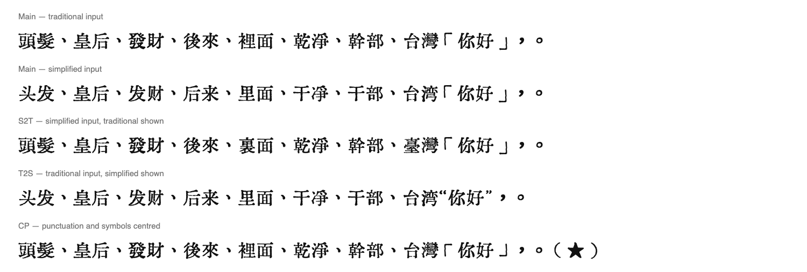

Main vs CP, horizontal and vertical:

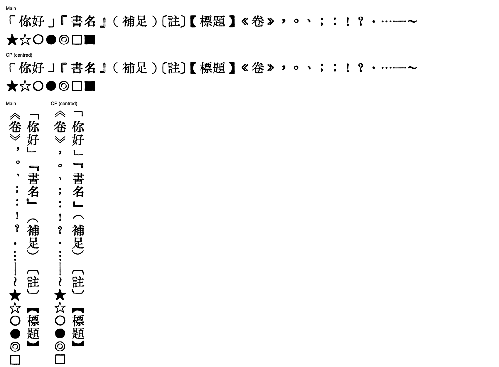

## Background

I prefer reading vertically. While setting up vertical text I ran into **tate-chu-yoko (縱中橫, upright digits/letters inside vertical lines)** and noticed that a number of symbols were missing from the font. A little later, reading a French book, **é would not display correctly**. So I started filling in what was missing, and the list grew: Latin Extended, Vietnamese, IPA, Greek, Cyrillic, vertical punctuation forms, circled and enclosed characters, units, radicals, box-drawing, and more.

Rules I kept throughout:

- **Everything is assembled from glyphs that already exist** in the font (plus the reference fonts listed below), joined and re-traced as vector outlines. No glyph was drawn free-hand or traced from a screenshot of another font, and no generative glyph model was used for the additions.
- **Existing hanzi and letters were not redrawn.** The only existing glyphs that differ from the original `HuiwenMincho-AI.ttf` are listed under [Changes to existing glyphs](#changes-to-existing-glyphs).
- The look follows the letterpress character of the font: rough edges, uneven weight, repeated parts that are not identical copies, strokes that stay inside the em box.
- Everything was reviewed by eye, glyph by glyph, in several rounds on a review page, and anything rejected was rebuilt.

## What this project builds on

This work stands on two projects, both derived from the original 汇文明朝体 by 特里王 (Wang Tingrui) / WNGNXAN:

1. **[bosswnx/huiwenmincho-improved](https://github.com/bosswnx/huiwenmincho-improved)** — corrects the width of full-width Chinese punctuation (《》「」『』【】！？：；（） and the vertical forms U+FE17–FE44) so it occupies one full em and is centred.
2. **HuiwenMincho-AI v1 by 木相 (Muxiang, Zhihu: D-xiang-11)** — the original font plus 16,026 missing CJK glyphs generated with a diffusion model (FontDiffuser) and vectorised. Its Han glyphs are used unchanged here. Article: <https://zhuanlan.zhihu.com/p/2073823068577870999>.

Original font: <https://zhuanlan.zhihu.com/p/344103391> (new releases by the original author: <https://zhuanlan.zhihu.com/p/12669052378>).

## What was added

Compared with `HuiwenMincho-AI.ttf` (30,096 code points) the main font has 32,696: **2,618 added, 18 removed** (see below). Added code points by block:

| Block | Added |
|---|---:|
| Latin-1 / Latin Extended-A/B (e.g. é, ă, ő, ǹ, ...) | 246 |
| IPA, spacing modifiers, combining marks | 5 |
| Latin Extended Additional (Vietnamese and the dotted/underlined Latin letters) | 244 |
| Greek and Coptic | 86 |
| Greek Extended (polytonic) | 230 |
| Cyrillic (incl. Komi, Abkhaz, etc.) | 223 |
| Cyrillic Supplement / Extended-B (selected historical letters) | 41 |
| General punctuation, letterlike forms, math | 97 |
| Superscripts, subscripts and currency signs (₣ ₦ ₩ ₭ ₮ ₱ ₽ ₿ ...) | 60 |
| Arrows | 96 |
| Enclosed alphanumerics | 94 |
| Box drawing and block elements | 128 |
| Geometric shapes | 73 |
| Miscellaneous symbols and dingbats | 122 |
| CJK / Kangxi radicals | 329 |
| Ideographic description characters | 12 |
| CJK symbols and punctuation, kana, bopomofo | 32 |
| Kanbun, bopomofo extended, CJK strokes, katakana phonetic extensions | 85 |
| Enclosed CJK and CJK compatibility (units, months, words, ...) | 355 |
| Vertical forms, CJK compatibility forms, small forms | 48 |
| Halfwidth and fullwidth forms | 12 |

No Han (CJK Unified Ideograph) code points were added.

Source of the italic letters: all italic/cursive letterforms were taken from IM Fell English Italic (see References).

### Changes to existing glyphs

470 existing code points differ from the original (outline or advance width). They are:

- punctuation and symbol width/position fixes, following `huiwenmincho-improved`, plus the vertical-layout tables (`vert`/`vrt2`, `vhea`/`vmtx`) added in this project: full-width and vertical forms, CJK symbols, compatibility forms — 74 fullwidth/halfwidth, 18 vertical/small forms, 46 enclosed CJK/compatibility, 11 CJK symbols, and similar;
- 94 Latin and 70 IPA glyphs, 31 combining marks and 39 math operators that were plain "default" (non-letterpress) shapes in the original and which I rebuilt in the letterpress style from existing parts;
- 32 box-drawing glyphs redone so that all 128 box characters join seamlessly;
- 7 radical-like Han glyphs (乀 冂 几 卜 彐 羋 臼) whose earlier crops had visible cut traces.

Everything else — in particular all other hanzi, kana and Latin letters — is byte-identical in outline to the original.

### Not carried over

18 code points present in the original are absent from this build: U+23BE–23CC (dentistry symbols), U+2603 ☃, U+260E ☎, U+3020 〠. Pictographic and game symbols are deliberately out of scope and are not included (e.g. chess and xiangqi pieces, mahjong tiles, playing cards, hexagrams, counting rods, recycling symbols, skull, biohazard, and most dingbats).

## S2T and T2S variants

Both were made with **[TCFontCreator](https://github.com/GuiWonder/TCFontCreator)** by GuiWonder (中文字体简繁处理工具; its otfcc core, "generate simplified-to-traditional / traditional-to-simplified font" mode). The one-to-many handling (e.g. 皇后 / 以后, 头发 / 发展, 干净 / 树干) uses the tool's phrase-matching mode. Two adjustments to the tool, made in a patched *copy* (not included): (1) it no longer deletes glyphs outside a short list (the stock phrase mode removes every symbol), and (2) it only keeps phrases whose result differs from the plain per-character mapping (9,900 of 48,696), so the phrase glyphs fit under the 65,535-glyph TrueType limit (the S2T font has 38,946 glyphs). Character coverage was checked: every one of the 32,696 code points of the main font is present in both variants.

## Language coverage

Latin (English, French, German, Spanish, Portuguese, Polish, Czech, Hungarian, Turkish, Romanian, Icelandic, ...), Vietnamese, Greek (modern and polytonic), Cyrillic (Russian, Ukrainian, Serbian, Bulgarian, Kazakh, ...), Chinese (traditional and simplified), Japanese (kana and kanji), bopomofo including Taiwanese/Hakka extensions, plus the symbols above. Arabic, Hebrew, Indic scripts, Thai and Hangul are not covered (for Hangul see the recommendation below). See [Specimens by language](#specimens-by-language).

**Hangul:** this font does not cover Hangul. For Hangul, **ChosunCentennial** (Chosun Centennial, Bang Il Young Foundation) is highly recommended: its forms match the style of this font very well, so set it as the fallback font for Hangul. It is not bundled or redistributed here; check its licence terms before using or redistributing it.

### Coverage by Unicode block

Code points present in `HuiwenMincho-AI-v2.1.ttf` out of the assigned characters in each block (control characters excluded; counted against Unicode 14.0, so blocks that grew in later versions may show slightly lower real coverage).

| Block | Range | Present / assigned | Coverage |
|---|---|---:|---:|
| Basic Latin | U+0020–007E | 95 / 95 | 100.0% |
| Latin-1 Supplement | U+00A0–00FF | 96 / 96 | 100.0% |
| Latin Extended-A | U+0100–017F | 128 / 128 | 100.0% |
| Latin Extended-B | U+0180–024F | 208 / 208 | 100.0% |
| IPA Extensions | U+0250–02AF | 56 / 96 | 58.3% |
| Spacing Modifier Letters | U+02B0–02FF | 18 / 80 | 22.5% |
| Combining Diacritical Marks | U+0300–036F | 32 / 112 | 28.6% |
| Greek and Coptic | U+0370–03FF | 135 / 135 | 100.0% |
| Cyrillic | U+0400–04FF | 249 / 256 | 97.3% |
| Cyrillic Supplement | U+0500–052F | 48 / 48 | 100.0% |
| Hangul Jamo | U+1100–11FF | 0 / 256 | 0.0% |
| Cyrillic Extended-C | U+1C80–1C8F | 9 / 9 | 100.0% |
| Latin Extended Additional | U+1E00–1EFF | 246 / 256 | 96.1% |
| Greek Extended | U+1F00–1FFF | 233 / 233 | 100.0% |
| General Punctuation | U+2000–206F | 111 / 111 | 100.0% |
| Superscripts and Subscripts | U+2070–209F | 42 / 42 | 100.0% |
| Currency Symbols | U+20A0–20CF | 19 / 33 | 57.6% |
| Letterlike Symbols | U+2100–214F | 10 / 80 | 12.5% |
| Number Forms | U+2150–218F | 35 / 60 | 58.3% |
| Arrows | U+2190–21FF | 112 / 112 | 100.0% |
| Mathematical Operators | U+2200–22FF | 60 / 256 | 23.4% |
| Miscellaneous Technical | U+2300–23FF | 5 / 256 | 2.0% |
| Control Pictures | U+2400–243F | 1 / 39 | 2.6% |
| Enclosed Alphanumerics | U+2460–24FF | 160 / 160 | 100.0% |
| Box Drawing | U+2500–257F | 128 / 128 | 100.0% |
| Block Elements | U+2580–259F | 32 / 32 | 100.0% |
| Geometric Shapes | U+25A0–25FF | 96 / 96 | 100.0% |
| Miscellaneous Symbols | U+2600–26FF | 175 / 256 | 68.4% |
| Dingbats | U+2700–27BF | 12 / 192 | 6.2% |
| CJK Radicals Supplement | U+2E80–2EFF | 115 / 115 | 100.0% |
| Kangxi Radicals | U+2F00–2FDF | 214 / 214 | 100.0% |
| Ideographic Description Characters | U+2FF0–2FFF | 12 / 12 | 100.0% |
| CJK Symbols and Punctuation | U+3000–303F | 61 / 64 | 95.3% |
| Hiragana | U+3040–309F | 93 / 93 | 100.0% |
| Katakana | U+30A0–30FF | 96 / 96 | 100.0% |
| Bopomofo | U+3100–312F | 43 / 43 | 100.0% |
| Hangul Compatibility Jamo | U+3130–318F | 0 / 94 | 0.0% |
| Kanbun | U+3190–319F | 16 / 16 | 100.0% |
| Bopomofo Extended | U+31A0–31BF | 32 / 32 | 100.0% |
| CJK Strokes | U+31C0–31EF | 36 / 36 | 100.0% |
| Katakana Phonetic Extensions | U+31F0–31FF | 16 / 16 | 100.0% |
| Enclosed CJK Letters and Months | U+3200–32FF | 192 / 255 | 75.3% |
| CJK Compatibility | U+3300–33FF | 256 / 256 | 100.0% |
| CJK Unified Ideographs Extension A | U+3400–4DBF | 6,582 / 6,592 | 99.8% |
| CJK Unified Ideographs | U+4E00–9FFF | 20,903 / 20,992 | 99.6% |
| Cyrillic Extended-B | U+A640–A69F | 30 / 96 | 31.2% |
| Hangul Syllables | U+AC00–D7AF | 0 / 11,172 | 0.0% |
| CJK Compatibility Ideographs | U+F900–FAFF | 350 / 472 | 74.2% |
| Vertical Forms | U+FE10–FE1F | 10 / 10 | 100.0% |
| CJK Compatibility Forms | U+FE30–FE4F | 32 / 32 | 100.0% |
| Small Form Variants | U+FE50–FE6F | 26 / 26 | 100.0% |
| Halfwidth and Fullwidth Forms | U+FF00–FFEF | 173 / 225 | 76.9% |

Not covered at all: Arabic, Hebrew, Indic scripts, Thai and most other scripts outside the blocks above.

## References and credits

The folder `Material Fonts/` (and `TCFontCreator/`) is **not uploaded** to this repository. What was used from where:

| Material | Author / licence | Used for |
|---|---|---|
| `HuiwenMincho-AI.ttf` | 特里王 (Wang Tingrui) / WNGNXAN; AI supplement by 木相 (Muxiang). Public Domain | The base font. Every glyph not listed above is taken from it unchanged. |
| `IMFellEnglish-Italic.ttf` | © Igino Marini, **SIL Open Font License 1.1** | Source of parts for all italic/cursive letterforms (e.g. ℓ-style letters, cal/kcal, cursive Latin/Greek letters). Glyphs derived from it remain under the OFL. |
| `OradanoGSRR.ttf` | Akira Uchida (内田明), Oradano-mincho-GSRR; the name table says Public Domain, the author's page grants free use/redistribution/derivatives (custom licence; `fsType` is 4, which contradicts the name table) | Allowed as a part source during the build (per-glyph provenance was not recorded). I also checked it as a candidate Japanese-region font; it draws old forms at many shinjitai code points, so no Japanese alternates were made from it. |
| `ChosunCentennial_ttf.ttf` | © Bang Il Young Foundation (see name ID 13 for the IP notice; `fsType` 4) | Allowed as a part source for some Latin shapes during the build (per-glyph provenance was not recorded). **Recommended companion font for Hangul**, which this font does not cover. Check its terms before redistributing. |
| macOS system fonts (Iowan Old Style, Arial, Times New Roman, Tahoma, STIX, DIN Condensed, Sarasa UI, Hiragino Mincho, Songti, ...) | their respective owners | Visual reference to decide the correct shape of rare letters. No outlines used. |
| [TCFontCreator](https://github.com/GuiWonder/TCFontCreator) (中文字体简繁处理工具) | GuiWonder; no licence is declared in its repository | Creates the S2T and T2S variants (its otfcc core, simplified↔traditional conversion with phrase matching). |
| fontTools, HarfBuzz (`hb-shape`), otfcc, Pillow | open source | Building and verifying the fonts. |

## Specimens by language

**English**

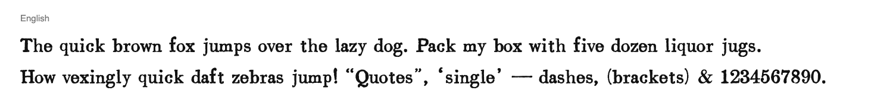

**Français**

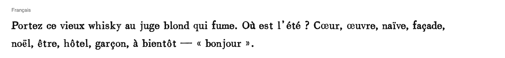

**Deutsch**

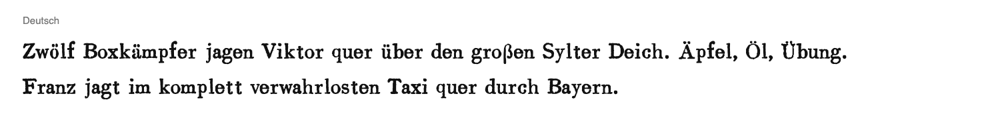

**Español**

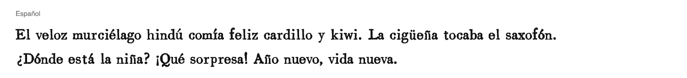

**Português**

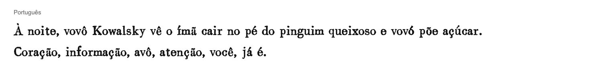

**Polski**

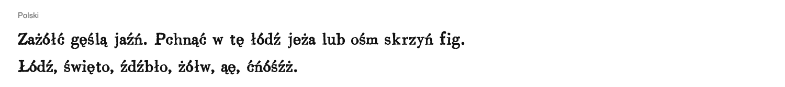

**Čeština**

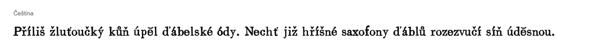

**Magyar**

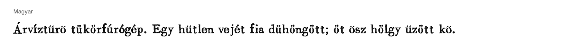

**Türkçe**

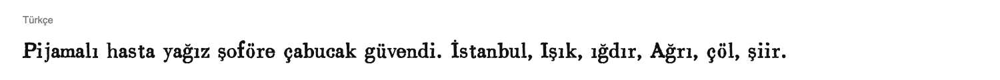

**Română**

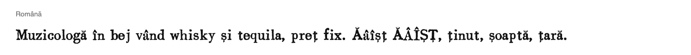

**Íslenska**

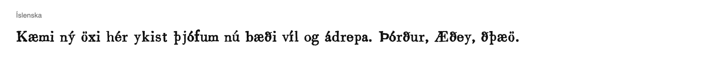

**Tiếng Việt**

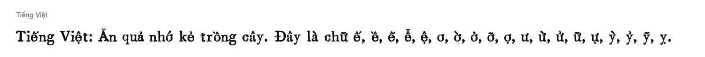

**Greek**

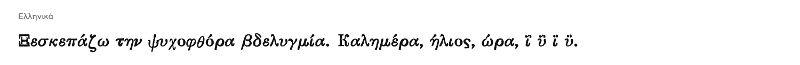

**Greek (polytonic)**

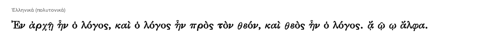

**Russian**

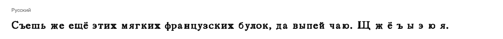

**Ukrainian**

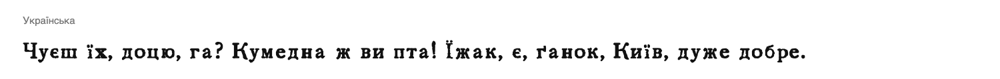

**Serbian**

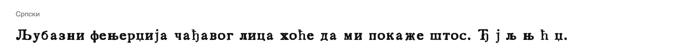

**Bulgarian**

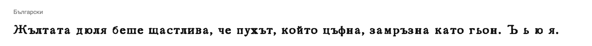

**Kazakh**

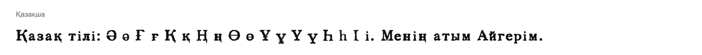

**Chinese (traditional)**

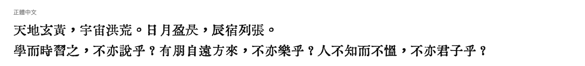

**Chinese (simplified)**

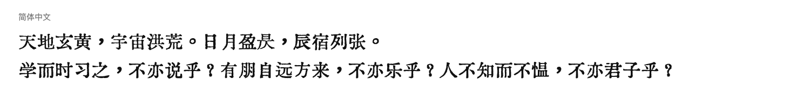

**Japanese**

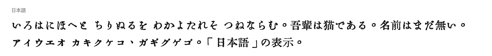

**Bopomofo**

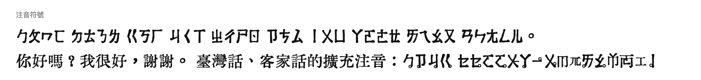

## Known issues

- Some historical Cyrillic letters were dropped after review; the remaining ones (U+1C80–1C88, parts of U+A644–A6A0) are accepted but few.
- The S2T/T2S phrase tables cover common words only; rare ambiguous characters fall back to a single default mapping.

## Licence

Same as the original font: **Public Domain**, with the exceptions noted above for parts derived from the OFL-licensed IM Fell English Italic.
