# HuiwenMincho-AI v2.1 — 多語言支援的鉛印風格字型

[English](README.md) | 正體中文

HuiwenMincho-AI v2.1 是匯文明朝體（汇文明朝体，鉛字風格）的擴充版，以**多語言支援**為主要目標：中文（正體與簡體）、日文、注音、拉丁字母（英、法、德、西、越南文、波蘭文、捷克文、土耳其文⋯⋯）、IPA、希臘文（含多調）與西里爾文，用同一套鉛印風格呈現，橫排直排皆可閱讀。它補上了約 2,600 個原本缺少的碼位（拉丁擴充、越南文、IPA、希臘文、西里爾文、直排用的標點與符號、帶圈與 CJK 符號、部首、注音擴充、製表符、貨幣、上下標⋯⋯），並附帶 **S2T**（簡體輸入、顯示正體）與 **T2S**（正體輸入、顯示簡體）兩種閱讀版本，以及不同的標點位置版本（見下）。

## 檔案

字型檔放在 [GitHub Release](https://github.com/SEKY443/HuiwenMincho-AI/releases/latest) 的附件中，不放進 git 歷史。

| 檔案 | 說明 |
|---|---|
| `HuiwenMincho-AI-v2.1.ttf` | **主字型。** 橫排標點（，。、；：！？）居中；直排字形維持傳統的右上位置。 |
| `HuiwenMincho-AI-v2.1-VC.ttf` | **V**ertical centred：直排的標點與符號字形居中於字面框；橫排標點用大陸式位置（左下／靠左）；橫排引號用 “ ” ‘ ’ 取代「」『』。 |
| `HuiwenMincho-AI-v2.1-AC.ttf` | **A**ll centred：所有全形標點與符號都居中，橫排直排皆然（類似 I.Ming 的「CP」版本）。 |
| `HuiwenMincho-AI-v2.1-NC.ttf` | **N**one centred：橫排用大陸式（，。、在左下角，；：！？靠左，引號為 “ ” ‘ ’），直排維持傳統右上字形。 |
| `…-S2T.ttf`／`…-T2S.ttf` | 以上四個版本各自都有 **S2T**（輸入簡體顯示正體，處理一簡對多繁，例如 后／後／皇后、发／發／髮、干／乾／幹／榦、里／裡／裏）與 **T2S**（輸入正體顯示簡體）兩個版本，共 12 個檔案，例如 `HuiwenMincho-AI-v2.1-VC-S2T.ttf`。 |
| `example/` | 用這些字型排出的樣張（各語言、各版本、橫排與直排）。 |

十二個檔案的內部名稱與授權資訊都與原字型一致（Public Domain，原作者的署名保留在字型的 name 表中）。

## 適用範圍

這套字型是**閱讀用**的（書籍、長文，直排橫排皆可），**不太適合拿來做 UI 設計**：鉛印的粗糙感、窄寬度的間隔符號與偏高的直排字面都是為連續文字調整的，不適合按鈕、選單或小尺寸的介面文字。

請依閱讀習慣選擇版本：混合文字用主字型；偏好閱讀正體字用 **S2T**（輸入或收到簡體字會顯示正體）；偏好簡體字用 **T2S**；標點位置依喜好選 **VC／AC／NC**（見下方對比），每個版本都有 S2T 與 T2S。

專案網址：<https://github.com/SEKY443/HuiwenMincho-AI>

## 樣張

製表符與各種文字、符號的混排，使用主字型。橫排：

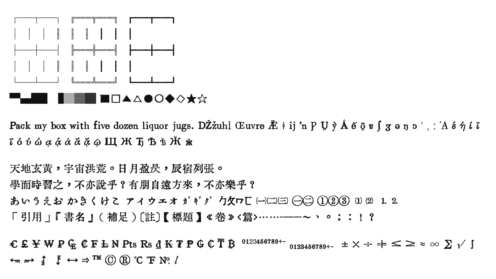

直排（由右至左，`writing-mode: vertical-rl`）：

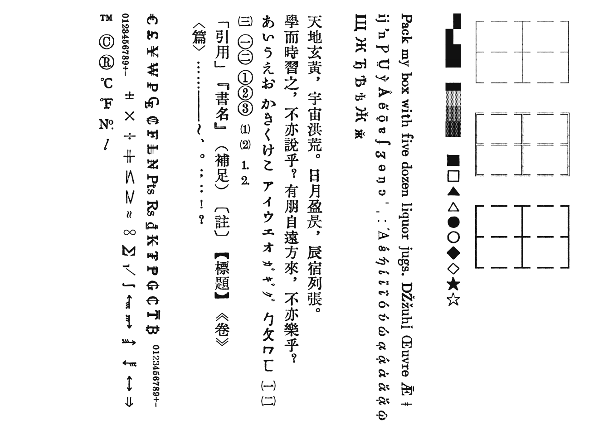

## 版本對比

同一段文字在各版本的顯示。S2T 輸入簡體會顯示正體，T2S 輸入正體會顯示簡體（轉換器也會把「」換成全寬的“”，這裡以一個字面框的寬度繪製），AC 則把標點與符號居中。

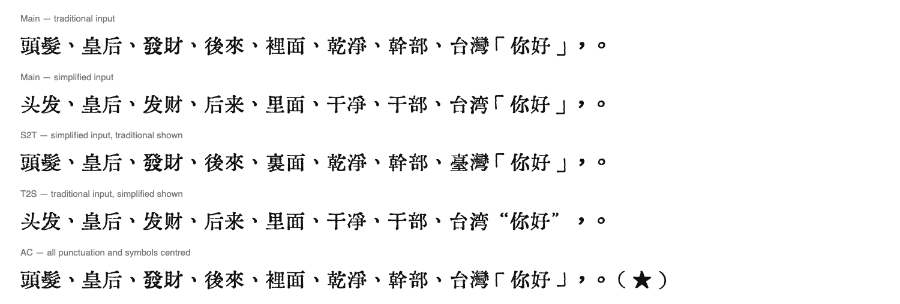

四個版本的標點位置對比（主字型＝橫排居中、VC＝直排居中、AC＝全部居中、NC＝全部不居中），橫排與直排：

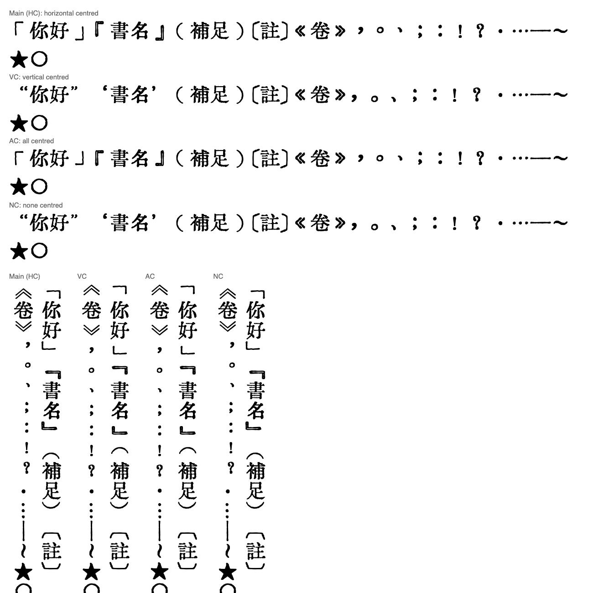

## 背景

我偏好直排閱讀。調整直排時遇到**縱中橫**（直排行中的直立數字、字母），發現字型缺了一些符號；不久之後在讀一本法文書時，**é 又無法正常顯示**。於是我開始順手補充缺的字，範圍越補越廣：拉丁擴充、越南文、IPA、希臘文、西里爾文、直排標點、帶圈與封閉字元、單位、部首、製表符等等。

整個過程遵守的原則：

- **全部都是用字型裡已有的字拼出來的**（外加下方列出的參考字型），以向量輪廓拼合、重新描線。沒有徒手畫，也沒有從別的字型截圖描摹，補字時沒有使用生成式的字形模型。
- **沒有重畫既有的漢字與字母。** 與原版 `HuiwenMincho-AI.ttf` 不同的既有字形，全部列在〈既有字形的更動〉。
- 外觀保留鉛字的氣質：毛邊、粗細不均、重複的部件不是同一個複本、筆畫不超出字框。
- 每一個字都在審查頁上逐字用眼睛審過、分多輪，被退回的都重做。

## 這個專案建立在什麼之上

本專案建立在兩個專案之上，兩者都源自特里王（Wang Tingrui）／WNGNXAN 的原版匯文明朝體：

1. **[bosswnx/huiwenmincho-improved](https://github.com/bosswnx/huiwenmincho-improved)**：修正全形中文標點（《》「」『』【】！？：；（）以及直排形式 U+FE17–FE44）的寬度，讓它佔滿一個字寬並置中。
2. **木相（Muxiang，知乎：D-xiang-11）的 HuiwenMincho-AI v1**：原字型加上用擴散模型（FontDiffuser）生成並向量化的 16,026 個缺字。本專案原樣沿用它的漢字。文章：<https://zhuanlan.zhihu.com/p/2073823068577870999>。

原字型：<https://zhuanlan.zhihu.com/p/344103391>（原作者的新版：<https://zhuanlan.zhihu.com/p/12669052378>）。

## 新增了什麼

與 `HuiwenMincho-AI.ttf`（30,096 個碼位）相比，主字型有 32,696 個：**新增 2,618 個、移除 18 個**（見下）。各區塊新增數量：

| 區塊 | 新增 |
|---|---:|
| 拉丁-1／拉丁擴充 A、B（例如 é、ă、ő、ǹ⋯⋯） | 246 |
| IPA、修飾字母、組合符號 | 5 |
| 拉丁擴充附加（越南文與帶點、帶下線的拉丁字母） | 244 |
| 希臘文與科普特文 | 86 |
| 希臘文擴充（多調） | 230 |
| 西里爾文（含科米語、阿布哈茲語等） | 223 |
| 西里爾擴充（少數歷史字母） | 41 |
| 一般標點、類字母、數學符號 | 97 |
| 上標、下標與貨幣符號（₣ ₦ ₩ ₭ ₮ ₱ ₽ ₿⋯⋯） | 60 |
| 箭頭 | 96 |
| 帶圈英數字 | 94 |
| 製表符與方塊元素 | 128 |
| 幾何圖形 | 73 |
| 雜項符號與裝飾符號 | 122 |
| CJK／康熙部首 | 329 |
| 表意文字描述字元 | 12 |
| CJK 符號與標點、假名、注音 | 32 |
| 漢文訓讀、注音擴充、CJK 筆畫、片假名語音擴充 | 85 |
| 帶圈 CJK 與 CJK 相容字元（單位、月份、詞語⋯⋯） | 355 |
| 直排形式、CJK 相容形式、小寫變體 | 48 |
| 半形與全形 | 12 |

沒有新增任何漢字（CJK 統一表意文字）。

斜體字母的出處：所有斜體／草書字形都取自 IM Fell English Italic（見參考資料）。

### 既有字形的更動

有 470 個既有碼位與原版不同（輪廓或字寬），它們是：

- 依照 `huiwenmincho-improved` 的標點和符號寬度／位置修正，以及本專案加入的直排排版表（`vert`／`vrt2`、`vhea`／`vmtx`）：全形與直排形式、CJK 符號、相容形式，包括半形全形 74 個、直排／小寫變體 18 個、帶圈 CJK 與相容字元 46 個、CJK 符號 11 個等；
- 94 個拉丁、70 個 IPA、31 個組合符號與 39 個數學運算符，在原版是一般「預設」（非鉛字）造型，我用現有部件以鉛字風格重做；
- 32 個製表符重做，讓 128 個製表符能無縫銜接；
- 7 個像部首的漢字（乀 冂 几 卜 彐 羋 臼），原本的裁切有明顯痕跡。

其餘所有字，尤其是其他漢字、假名與拉丁字母，輪廓與原版完全相同。

### 沒有帶進來的

原版有、這個版本沒有的碼位有 18 個：U+23BE–23CC（牙科符號）、U+2603 ☃、U+260E ☎、U+3020 〠。圖形類與遊戲類符號刻意不做、沒有收錄（例如西洋棋與中國象棋棋子、麻將牌、撲克牌、易經卦象、算籌、回收標誌、骷髏、生化危害，以及大部分裝飾符號）。

## S2T 與 T2S 版本

兩者都用 GuiWonder 的 **[TCFontCreator](https://github.com/GuiWonder/TCFontCreator)**（中文字体简繁处理工具；使用它的 otfcc 核心、「生成簡轉繁／繁轉簡字型」模式）製作。一簡對多繁的處理（例如 皇后／以后、头发／发展、干净／树干）用的是工具的詞彙匹配模式。我在一份修改過的*複本*（未包含在此）裡對工具做了兩處調整：（1）不再刪除名單以外的字形（工具原本的詞彙模式會把所有符號刪光）；（2）只保留「結果與逐字轉換不同」的詞（48,696 個中的 9,900 個），讓詞彙字形不超過 TrueType 的 65,535 字形上限（S2T 版有 38,946 個字形）。已檢查字元完整性：主字型的 32,696 個碼位在兩個版本中都齊全。

## 語言涵蓋範圍

拉丁文（英、法、德、西、葡、波蘭、捷克、匈牙利、土耳其、羅馬尼亞、冰島⋯⋯）、越南文、希臘文（現代與多調）、西里爾文（俄、烏克蘭、塞爾維亞、保加利亞、哈薩克⋯⋯）、中文（正體與簡體）、日文（假名與漢字）、含台語與客語擴充的注音，以及上述符號。不涵蓋阿拉伯文、希伯來文、印度系文字、泰文與諺文（諺文的建議見下）。請見 `example/language_specimen_*.png`。

**諺文：** 本字型不含諺文。諺文非常推薦搭配 **ChosunCentennial**（朝鮮百年體，Bang Il Young Foundation），它的字形與本字型的風格十分契合，建議把它設為諺文的備用字型。本專案不附帶也不散布它；使用或散布前請先確認它的授權條款。

### 各 Unicode 區塊的涵蓋情況

`HuiwenMincho-AI-v2.1.ttf` 在每個區塊中，已有碼位數／已分配字元數（不含控制字元；以 Unicode 14.0 計算，所以在更新版本中擴充過的區塊，實際涵蓋率可能略低）。

| 區塊 | 範圍 | 已有／已分配 | 涵蓋率 |
|---|---|---:|---:|
| 基本拉丁 | U+0020–007E | 95 / 95 | 100.0% |
| 拉丁-1 補充 | U+00A0–00FF | 96 / 96 | 100.0% |
| 拉丁擴充 A | U+0100–017F | 128 / 128 | 100.0% |
| 拉丁擴充 B | U+0180–024F | 208 / 208 | 100.0% |
| IPA 擴充 | U+0250–02AF | 56 / 96 | 58.3% |
| 修飾字母 | U+02B0–02FF | 18 / 80 | 22.5% |
| 組合附加符號 | U+0300–036F | 32 / 112 | 28.6% |
| 希臘文與科普特文 | U+0370–03FF | 135 / 135 | 100.0% |
| 西里爾文 | U+0400–04FF | 249 / 256 | 97.3% |
| 西里爾補充 | U+0500–052F | 48 / 48 | 100.0% |
| 諺文字母 | U+1100–11FF | 0 / 256 | 0.0% |
| 西里爾擴充 C | U+1C80–1C8F | 9 / 9 | 100.0% |
| 拉丁擴充附加（越南文等） | U+1E00–1EFF | 246 / 256 | 96.1% |
| 希臘文擴充（多調） | U+1F00–1FFF | 233 / 233 | 100.0% |
| 一般標點 | U+2000–206F | 111 / 111 | 100.0% |
| 上下標 | U+2070–209F | 42 / 42 | 100.0% |
| 貨幣符號 | U+20A0–20CF | 19 / 33 | 57.6% |
| 類字母符號 | U+2100–214F | 10 / 80 | 12.5% |
| 數字形式 | U+2150–218F | 35 / 60 | 58.3% |
| 箭頭 | U+2190–21FF | 112 / 112 | 100.0% |
| 數學運算符 | U+2200–22FF | 60 / 256 | 23.4% |
| 雜項技術符號 | U+2300–23FF | 5 / 256 | 2.0% |
| 控制圖片 | U+2400–243F | 1 / 39 | 2.6% |
| 帶圈英數字 | U+2460–24FF | 160 / 160 | 100.0% |
| 製表符 | U+2500–257F | 128 / 128 | 100.0% |
| 方塊元素 | U+2580–259F | 32 / 32 | 100.0% |
| 幾何圖形 | U+25A0–25FF | 96 / 96 | 100.0% |
| 雜項符號 | U+2600–26FF | 175 / 256 | 68.4% |
| 裝飾符號 | U+2700–27BF | 12 / 192 | 6.2% |
| CJK 部首補充 | U+2E80–2EFF | 115 / 115 | 100.0% |
| 康熙部首 | U+2F00–2FDF | 214 / 214 | 100.0% |
| 表意文字描述字元 | U+2FF0–2FFF | 12 / 12 | 100.0% |
| CJK 符號與標點 | U+3000–303F | 61 / 64 | 95.3% |
| 平假名 | U+3040–309F | 93 / 93 | 100.0% |
| 片假名 | U+30A0–30FF | 96 / 96 | 100.0% |
| 注音符號 | U+3100–312F | 43 / 43 | 100.0% |
| 諺文相容字母 | U+3130–318F | 0 / 94 | 0.0% |
| 漢文訓讀 | U+3190–319F | 16 / 16 | 100.0% |
| 注音擴充 | U+31A0–31BF | 32 / 32 | 100.0% |
| CJK 筆畫 | U+31C0–31EF | 36 / 36 | 100.0% |
| 片假名語音擴充 | U+31F0–31FF | 16 / 16 | 100.0% |
| 帶圈 CJK 字母與月份 | U+3200–32FF | 192 / 255 | 75.3% |
| CJK 相容字元 | U+3300–33FF | 256 / 256 | 100.0% |
| CJK 統一表意文字擴充 A | U+3400–4DBF | 6,582 / 6,592 | 99.8% |
| CJK 統一表意文字 | U+4E00–9FFF | 20,903 / 20,992 | 99.6% |
| 西里爾擴充 B | U+A640–A69F | 30 / 96 | 31.2% |
| 諺文音節 | U+AC00–D7AF | 0 / 11,172 | 0.0% |
| CJK 相容表意文字 | U+F900–FAFF | 350 / 472 | 74.2% |
| 直排形式 | U+FE10–FE1F | 10 / 10 | 100.0% |
| CJK 相容形式 | U+FE30–FE4F | 32 / 32 | 100.0% |
| 小寫變體 | U+FE50–FE6F | 26 / 26 | 100.0% |
| 半形與全形 | U+FF00–FFEF | 173 / 225 | 76.9% |

完全沒有涵蓋：阿拉伯文、希伯來文、印度系文字、泰文，以及上表以外的大多數文字。

## 參考資料與致謝

資料夾 `Material Fonts/`（以及 `TCFontCreator/`）**不會上傳**到這個儲存庫。各項用到了什麼：

| 材料 | 作者／授權 | 用途 |
|---|---|---|
| `HuiwenMincho-AI.ttf` | 特里王（Wang Tingrui）／WNGNXAN；AI 補字：木相（Muxiang）。Public Domain | 基底字型。上面未列出的字形都原樣取自它。 |
| `IMFellEnglish-Italic.ttf` | © Igino Marini，**SIL Open Font License 1.1** | 所有斜體／草書字形的部件來源（如 ℓ 類字母、cal／kcal、草書拉丁與希臘字母）。由它衍生的字形仍屬於 OFL。 |
| `OradanoGSRR.ttf` | 内田明（Akira Uchida），Oradano-mincho-GSRR；name 表標示 Public Domain，作者頁面允許自由使用、散布與衍生（自訂授權；`fsType` 為 4，與 name 表矛盾） | 建構時允許作為部件來源（未記錄逐字來源）。我也把它當作日本區域字型的候選來檢查，但它在許多日本新字體碼位畫的是舊字，所以沒有用它做日文替代字形。 |
| `ChosunCentennial_ttf.ttf` | © Bang Il Young Foundation（智慧財產權聲明見 name ID 13；`fsType` 4） | 建構時允許作為部分拉丁字形的部件來源（未記錄逐字來源）。**諺文的建議搭配字型**，本字型不含諺文。散布前請確認它的條款。 |
| macOS 系統字型（Iowan Old Style、Arial、Times New Roman、Tahoma、STIX、DIN Condensed、Sarasa UI、Hiragino Mincho、Songti⋯⋯） | 各自的所有者 | 作為視覺參考，用來判斷罕用字母的正確形狀。沒有使用任何輪廓。 |
| [TCFontCreator](https://github.com/GuiWonder/TCFontCreator)（中文字体简繁处理工具） | GuiWonder；其儲存庫未標示授權 | 製作 S2T 與 T2S 版本（使用它的 otfcc 核心、含詞彙匹配的簡繁轉換）。 |
| fontTools、HarfBuzz（`hb-shape`）、otfcc、Pillow | 開源 | 建構與驗證字型。 |

## 各語言樣張

**English**

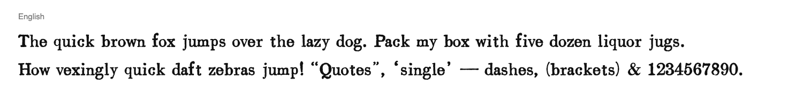

**Français**

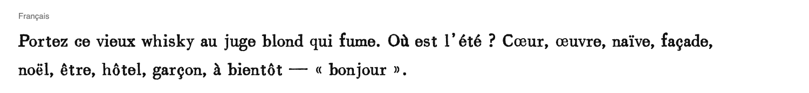

**Deutsch**

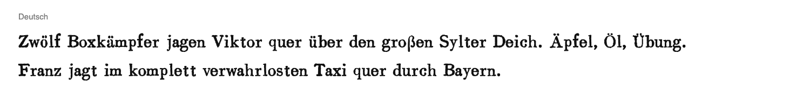

**Español**

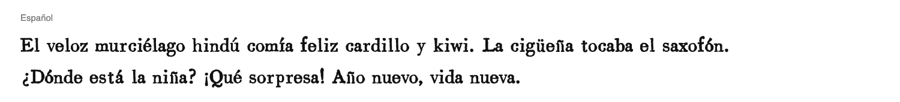

**Português**

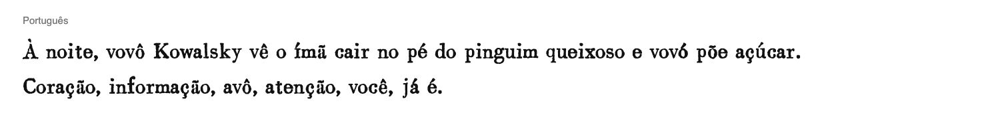

**Polski**

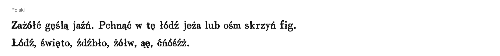

**Čeština**

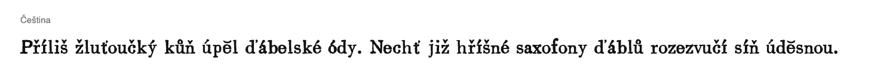

**Magyar**

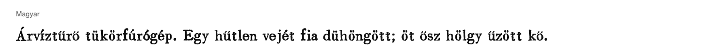

**Türkçe**

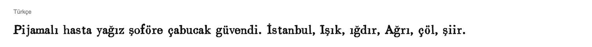

**Română**

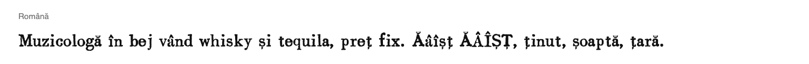

**Íslenska**

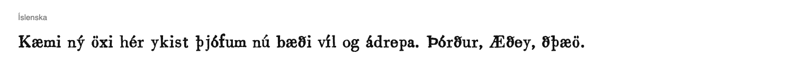

**Tiếng Việt**

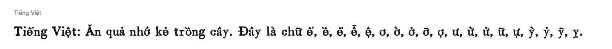

**希臘文**

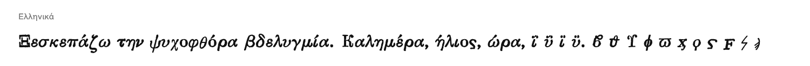

**希臘文（多調）**

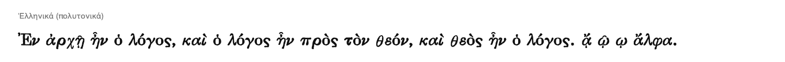

**俄文**

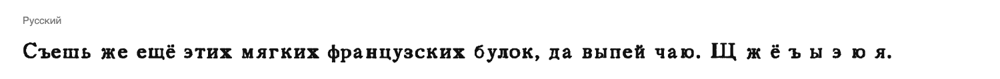

**烏克蘭文**

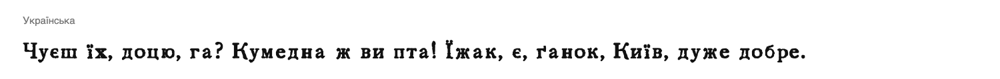

**塞爾維亞文**

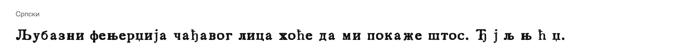

**保加利亞文**

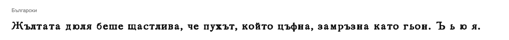

**哈薩克文**

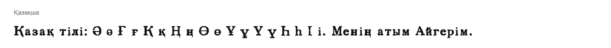

**正體中文**

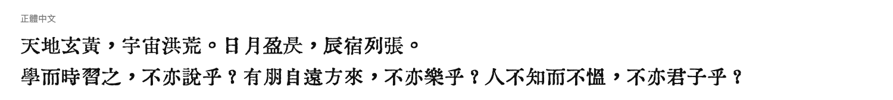

**簡體中文**

**日文**

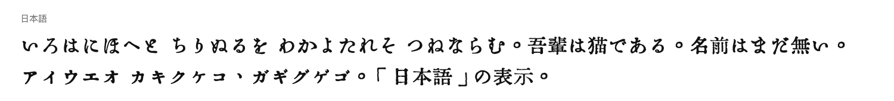

**注音**

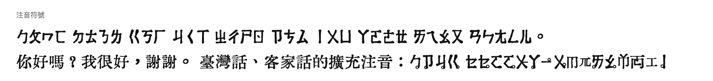

## 已知問題

- 部分歷史西里爾字母在審查後被捨棄；留下的（U+1C80–1C88、U+A644–A6A0 的一部分）已通過，但數量不多。
- S2T／T2S 的詞彙表只涵蓋常用詞；罕見的歧義字退回單一預設對應。

## 授權

與原字型相同：**Public Domain**，唯由 OFL 授權的 IM Fell English Italic 衍生的部分除外（見上）。
